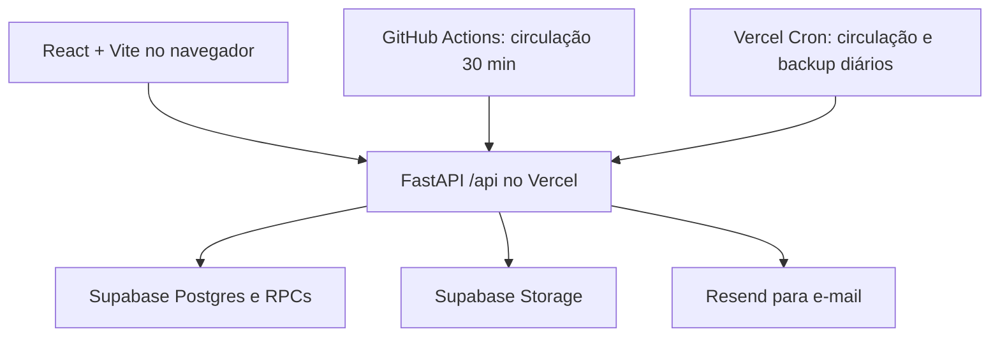

# Arquitetura e pontos de extensão

Referência: `main` em `f324048` (11/10/2026).

## Caminho de uma requisição

- A interface usa `react-router-dom` com rotas por hash e páginas carregadas sob demanda (`src/App.jsx`). `src/services/api.js` centraliza chamadas e o token. O frontend não acessa tabelas do Supabase diretamente.
- A entrada de produção é `api/index.py`; `vercel.json` reescreve `/api/*` para a função Python. Localmente, `uvicorn main:app --app-dir src/backend --reload --port 5000` expõe as rotas sem o prefixo `/api`; o proxy/cliente fornece esse caminho ao navegador.
- `src/backend/main.py` registra os routers, CORS, `X-Request-ID` e tratamento de erros. `core.py` emite e valida JWT próprio; `database.py` cria o cliente Supabase com chave de serviço **somente no servidor**.
- As regras transacionais mais sensíveis ficam em RPCs versionadas em `supabase/migrations`: criação/transição de movimentações, prazos, backup, fechamento letivo e avaliação. O backend valida o perfil antes de chamá-las. As tabelas de negócio têm acesso direto restrito a `anon` e `authenticated`; não considere a posse de um JWT da aplicação como autorização direta no Data API do Supabase.
- `capas` é público para leitura de imagens; `backups` é privado. Credenciais do Storage e do serviço de e-mail permanecem no backend.

## Perfis e limites de acesso

| Perfil | Acesso principal | Verificação no backend |
|---|---|---|
| Visitante | Catálogo público e autenticação | Rotas públicas; somente títulos e exemplares ativos no detalhe público. |
| Aluno ou comunidade | Área pessoal, solicitação, empréstimos e perfil | `get_user`; conta ativa, senha provisória trocada. Recomendações/avaliações exigem aluno. |
| Professor | Painel próprio, solicitação para si/turma, devolução dos próprios empréstimos | `get_professor`; é uma conta `Administrador` com `admProfessor=true`. |
| Gestor | Catálogo de gestão, circulação, usuários, relatórios, configurações, backup | `get_admin`; conta administrativa sem `admProfessor`. |

O token identifica a conta por e-mail, tipo, versão de token e epoch global. A API verifica o status e a versão da conta em cada autenticação. Redefinição de senha e restauração podem invalidar sessões. Para mudanças de permissão, implemente validação na API e na camada de dados; ocultar uma página no React não autoriza uma operação.

## Onde alterar cada assunto

| Assunto | Código e dados de referência |
|---|---|
| Catálogo, exemplares e tombos | `src/backend/routers/livros.py`, `schemas.py`, migrations de catálogo; telas `src/pages/Admin/CadastroLivros` e `src/pages/user/Biblioteca`. |
| Solicitação, aprovação, retirada, devolução e renovação | `src/backend/routers/emprestimos.py`, `professor.py`, `20261010230252_circulacao_transacional.sql`. |
| Login, perfis e senhas | `routers/auth.py`, `core.py`, `routers/usuarios.py`, `routers/admins.py`, migration de contas/sessões. |
| Fechamento letivo | `routers/ano_letivo.py`, `20261010230315_backup_ano_outbox.sql`. |
| Recomendações e avaliações | `routers/recomendacoes.py`, `recommendations/engine.py`, migration `20261011194555_recomendacoes_alunos.sql`. |
| Jobs, notificações e backups | `routers/emails.py`, `routers/backup.py`, `vercel.json`, `.github/workflows/circulacao.yml`. |
| Relatórios | `routers/relatorios.py`, `src/pages/Admin/Relatorios`. |

## Desenvolvimento

O [README da raiz](../README.md) contém instalação e comandos de teste. As migrations timestampadas em `supabase/migrations` são a fonte de instalação; `supabase/legacy_migrations` é arquivo histórico. Um ambiente já em produção exige comparação do histórico remoto antes de qualquer SQL: [procedimento](APLICACAO_MIGRATIONS.md).

Para novas funcionalidades, registre contrato de entrada/saída da API, papel autorizado, mudança de schema, estados possíveis e teste de regressão do fluxo. Prefira operações indivisíveis em RPC para alterações simultâneas em movimentação, exemplar e notificações.
