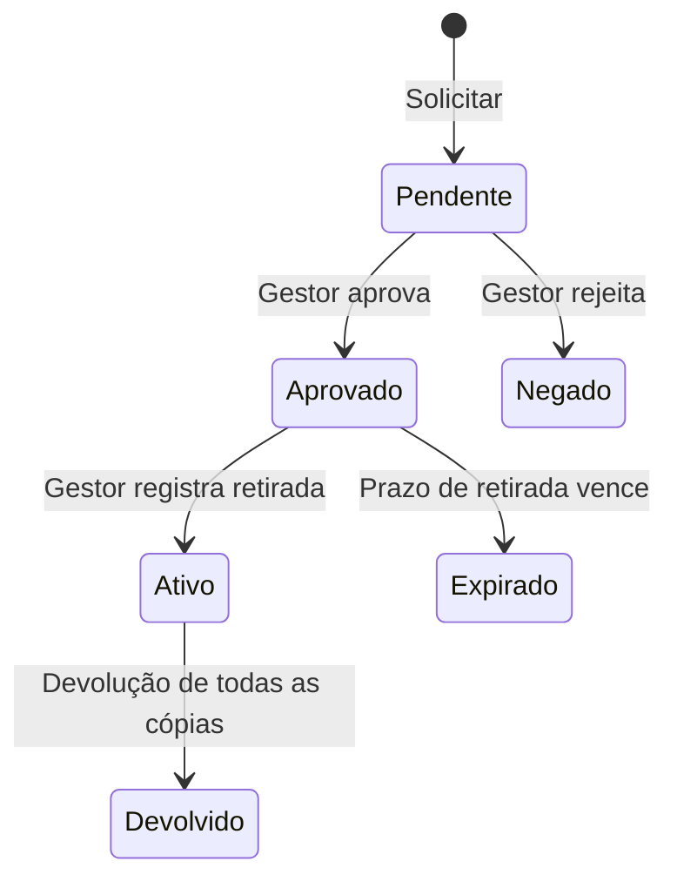

# Regras de negócio e fluxos

Referência: routers, schemas e migrations da `main` em `f324048` (11/10/2026). Valores configuráveis são exemplos de padrão no código; confirme os valores atuais pela API antes de informar um prazo a alguém.

## Catálogo e cópias

- `Livro` representa o título; `Exemplar` representa uma cópia com tombo e estado físico. Um título pode ter várias cópias. O gestor cadastra títulos, exemplares, autores, gêneros e ficha catalográfica.
- O catálogo público mostra títulos ativos com exemplar ativo. O detalhe público retorna 404 para título inativo ou sem cópia ativa. A gestão usa `/livros/gestao` e `/livros/gestao/{idLivro}` autenticados; o total de títulos do dashboard administrativo usa a regra de `/livros/resumo`.
- Uma solicitação só seleciona uma cópia disponível, de título ativo. Ao solicitar, a cópia fica `Reservado`; na retirada, `Emprestado`; após devolução ou encerramento da reserva, `Disponível`, conforme a transição autorizada.

## Circulação de usuários

- Aluno ou comunidade com conta habilitada solicita um título pelo acervo. A API reserva uma cópia disponível em uma transação; o usuário acompanha o andamento em “Meus empréstimos”. O gestor aprova ou rejeita solicitações e registra a retirada física. A solicitação aprovada não equivale a livro já retirado.
- O prazo de retirada começa na aprovação. `prazo_confirmacao_horas` tem padrão de **48 horas**; `alerta_expiracao_horas` tem padrão de **2 horas**. O prazo real depende da configuração e do instante gravado para a solicitação. Solicitação vencida não pode ser retirada; o processamento automático libera a reserva.
- Após a retirada, o prazo padrão do empréstimo é `dias_emprestimo=14`. O limite padrão de cópias em solicitações/empréstimos em curso é `livros_por_aluno=3` (a regra da RPC se aplica a contas de usuário). Renovação é feita pelo gestor por exemplar, com uma nova data posterior e limite padrão `maximo_renovacoes=2`. A devolução pode ser parcial; a movimentação encerra quando não restam itens ativos.
- Não garanta disponibilidade ou data de retirada com base em texto estático: elas dependem do banco, do horário de São Paulo, da configuração e do processamento da fila.

## Professor

- Professor usa conta administrativa marcada como `admProfessor`, com área própria. Escolhe finalidade `PESSOAL` ou `TURMA`; para turma, informa turma e pode incluir série. Pode selecionar vários títulos e quantidades em uma solicitação. A RPC reserva cópias disponíveis e cria uma solicitação pendente para aprovação do gestor.
- O professor acompanha suas solicitações e empréstimos e registra devolução de seus próprios exemplares. A API valida a vinculação do professor antes da devolução. A gestão conserva as ações de aprovação e retirada.

## Recomendações e avaliações

- Apenas aluno ativo com acesso liberado usa `/aluno/recomendacoes/painel`, `/aluno/recomendacoes` e `/aluno/avaliacoes`. O painel combina catálogo e histórico para sugestões; são recomendações, não garantia de disponibilidade nem decisão automatizada de empréstimo.
- O aluno só pode atribuir nota de 1 a 5 a um título **depois de uma devolução confirmada dele próprio**. A avaliação é persistida em `AvaliacaoLivro` e pode ser atualizada. As respostas pessoais usam `Cache-Control: private, no-store`.
- O cálculo atual consulta catálogo e histórico globais por painel. Há um ponto de acompanhamento de capacidade antes de ampliar muito a base; veja [resolução da auditoria](RESOLUCAO_AUDITORIA_20261011.md).

## Ano letivo, contas e configuração

- Só o gestor encerra o ano. A operação exige senha e frase de confirmação, recebe a lista explícita de alunos retidos e valida séries elegíveis. A RPC registra o resultado, promove os demais conforme a série e marca concluintes; empréstimos anteriores preservam seus dados históricos. Faça conferência da lista antes de executar: é uma operação administrativa em lote.
- Alunos importados usam recuperação de senha individual; contas com senha provisória precisam defini-la antes de usar as rotas de empréstimo. Gestores não devem divulgar senhas, tokens ou dados pessoais para suporte genérico.
- `Configuracoes` contém limites de empréstimo, prazo, sessão e notificações. Os valores públicos são filtrados pela API; edição exige gestor. `autenticacao_dois_fatores`, `notificacao_sms`, `modo_debug` e `modo_manutencao` estão explicitamente indisponíveis no backend atual.

## Notificações e falhas

E-mails são enfileirados no banco e enviados por processo autenticado. O job de circulação processa prazos e fila; `CRON_SECRET` protege o endpoint. Agendamentos podem atrasar; uma mensagem de e-mail não prova por si só o estado atual da reserva. Em falha de rede ou erro 5xx, consulte o estado da solicitação antes de reenviar a operação. Clientes podem enviar `Idempotency-Key` nas criações para evitar duplicação após repetição.

## Busca

Todas as pesquisas de texto (catálogo, listas do painel, empréstimos, relatórios e Novi) seguem a mesma regra, implementada em `src/backend/busca.py`, `src/utils/busca.js` e na função SQL `public.busca_normalizar`:

- **Busca exata:** ignora acentos, maiúsculas e pontuação, e exige que todas as palavras digitadas apareçam no texto, em qualquer ordem e em qualquer campo pesquisável. Códigos como tombo, RA e CPF são comparados sem pontuação (`t001` encontra `T-001`).
- **Busca aproximada:** só roda quando a exata não encontra nada. Tolera uma ou duas letras trocadas, faltando ou invertidas. Números, códigos e palavras com menos de quatro letras nunca usam a aproximada. No catálogo público a API devolve `aproximado: true` e a tela avisa que os resultados são parecidos com o que foi digitado.

Alterar a normalização exige ajustar os três pontos juntos. Os casos de `src/utils/buscaCasos.json` são testados em Jest e pytest e servem de referência para conferir a função SQL.

